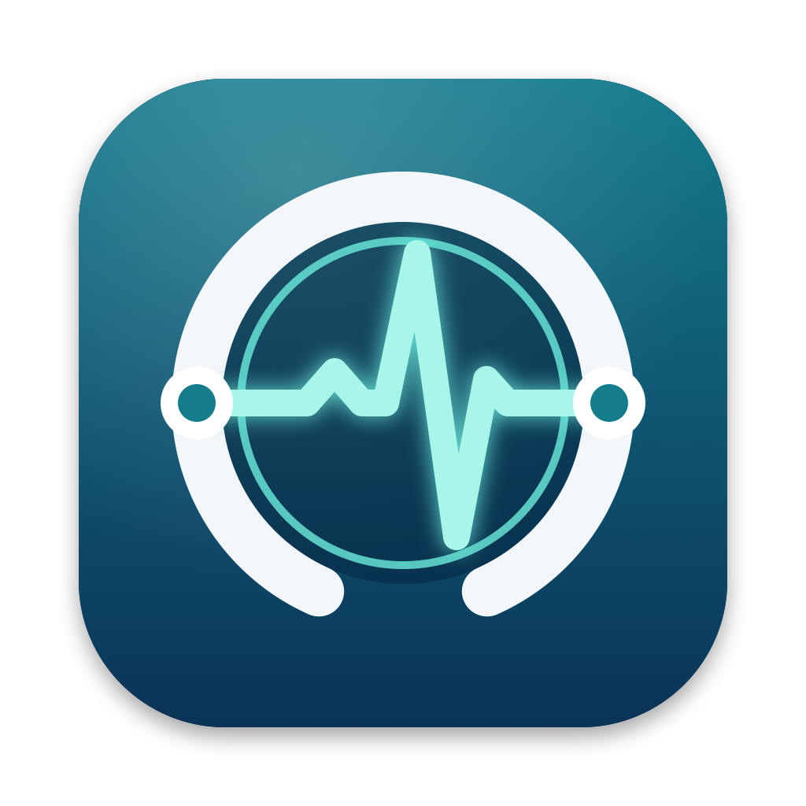

<p align="center">
  
</p>

<h1 align="center">DICOM Test Tool für macOS</h1>

<p align="center">
  <b>Natives macOS-Werkzeug zum Testen und zur Fehlersuche von DICOM-Verbindungen</b><br>
  Echo · Store · Query/Retrieve · Worklist · Storage SCP · Watchdog · Viewer
</p>

<p align="center">
  
  
  
  
</p>

<p align="center">
  <a href="../../releases/latest"><b>⬇️ Neueste Version herunterladen (DMG)</b></a> ·
  <a href="https://masenft.github.io/DICOMTestTool/de/">Website</a> ·
  <a href="README.md">🇬🇧 English version</a>
</p>

---

## Worum geht es?

**DICOM Test Tool für macOS** ist ein kostenloses Open-Source-Programm für den Mac. Administratoren, Medizintechnikerinnen und Medizintechniker sowie der IT-Support in Radiologie, Kliniken und Praxen prüfen damit schnell, ob die Kommunikation zwischen PACS, RIS, Modalitäten und Befundstationen funktioniert – und finden heraus, woran es hakt, wenn sie es nicht tut.

Die App ist vollständig in Swift geschrieben und bringt eine **eigene DICOM-Implementierung ohne Fremdbibliotheken** mit.

> [!WARNING]
> **Nur für IT und Verbindungstests – nicht für diagnostische Zwecke.**
> Die Software ist **kein Medizinprodukt** im Sinne der Verordnung (EU) 2017/745 (MDR). Sie darf nicht zur Befundung, Diagnose, Therapieplanung oder für andere medizinische Entscheidungen verwendet werden. Die Bildanzeige dient nur der technischen Kontrolle übertragener Daten.

## Funktionen

| Werkzeug | Was es macht |
|---|---|
| 🖧 **Knoten & Einstellungen** | Gegenstellen mit AE-Titel, Host und Port verwalten; eigener Calling AE und Timeout |
| 📡 **Echo (Verification)** | C-ECHO als „DICOM-Ping“ mit Zeitmessung (Assoziation, Echo, gesamt) und Wiederholungen |
| 📤 **Store (Senden)** | C-STORE von Dateien und Ordnern per Drag & Drop; Testbild-Generator ohne echte Patientendaten; automatische Umwandlung Implicit ↔ Explicit VR |
| 🔍 **Query / Retrieve** | C-FIND (Study/Patient Root) auf Patient-, Studien-, Serien- und Bildebene; Drill-down per Doppelklick; C-MOVE zu beliebigem Ziel |
| 📋 **Worklist** | Modality-Worklist-Abfrage beim RIS – so, wie es eine Modalität tun würde |
| 📥 **Storage SCP** | Macht den Mac zum DICOM-Empfänger; speichert sortiert nach Patienten-ID; ideal als C-MOVE-Ziel |
| ❤️ **Watchdog** | Überwacht Knoten dauerhaft per C-ECHO und meldet Ausfall und Wiederherstellung als macOS-Mitteilung |
| 🖼️ **Viewer / Tag-Dump** | Alle Tags inklusive Sequenzen mit Filter; Bildanzeige mit Fensterung, Multiframe, JPEG/JPEG 2000, PNG-Export |

**Außerdem:**

- 📍 **Menüleisten-Symbol** – SCP und Watchdog starten und stoppen, Echo senden, jedes Werkzeug öffnen, auch über Vollbild-Programmen
- 📝 **Protokoll** aller Abläufe inklusive Presentation-Context-Aushandlung, als TXT exportierbar
- 📅 **Datumsfelder mit Kalender** – oder direkt eintippen als `TTMMJJJJ` bzw. `TT.MM.JJJJ`
- 🎓 **Geführte Einführung** durch alle Werkzeuge
- 🎨 **Farbschemata:** Standard (macOS) oder Klinik Dunkel (Schwarz/Orange)
- 🔄 **Automatische Updates** über GitHub-Releases, mit Release Notes und Prüfung von Prüfsumme und Signatur
- 🚀 Start bei Anmeldung, Autostart von SCP und Watchdog, Log-Dateien (30 Tage)

## Installation

1. Unter [**Releases**](../../releases/latest) die Datei **`DICOM-Test-Tool.dmg`** herunterladen.
2. Die DMG-Datei per Doppelklick öffnen.
3. Im Fenster das Symbol **DICOM Test Tool** auf den Ordner **Programme** ziehen.
4. Das Fenster schließen und im Finder links neben „DICOM Test Tool 1.x“ auf ⏏ klicken (auswerfen).
5. Die App aus dem Programme-Ordner oder über Spotlight (`⌘ Leertaste`, „DICOM“) starten.

Die Datei `DICOM-Test-Tool.zip` im Release wird von der eingebauten Update-Funktion verwendet und muss nicht heruntergeladen werden.

> [!IMPORTANT]
> **Beim ersten Start** blockiert macOS die App, weil sie nicht über den kostenpflichtigen Apple-Notarisierungsdienst beglaubigt ist.
> So geben Sie sie einmalig frei:
> 1. Die Meldung mit **Fertig** schließen.
> 2. **Systemeinstellungen › Datenschutz & Sicherheit** öffnen.
> 3. Ganz unten bei *„DICOM Test Tool“ wurde blockiert* auf **Dennoch öffnen** klicken und mit dem Passwort bestätigen.
>
> Danach startet die App ganz normal. Spätere Updates über die App brauchen diese Freigabe nicht erneut.

**Systemvoraussetzungen:** macOS 14 (Sonoma) oder neuer, Apple Silicon oder Intel.

## 🪟 Windows-Version (Vorabversion)

Seit Version 1.4 gibt es das **DICOM Test Tool für Windows** mit denselben Werkzeugen (Echo, Store, Query/Retrieve, Worklist, Storage SCP, Watchdog, Viewer), Symbol im Infobereich, Windows-Benachrichtigungen und automatischen Updates. Der Viewer dekodiert zusätzlich JPEG Lossless, JPEG-LS und RLE.

1. Im [Release v1.4.0-beta.1](https://github.com/masenft/DICOMTestTool/releases/tag/v1.4.0-beta.1) die Datei **`DICOM-Test-Tool-win-Setup.exe`** herunterladen und starten – ohne Administratorrechte.
2. **Beim ersten Start** meldet Windows SmartScreen *„Der Computer wurde durch Windows geschützt“*, weil das Setup nicht signiert ist: auf **Weitere Informationen** › **Trotzdem ausführen** klicken.
3. Die App erscheint im Startmenü als **DICOM Test Tool für Windows**. Für den Storage SCP fragt die Windows-Firewall beim ersten Start nach – **Private Netzwerke** erlauben (Administratorrechte nötig). Alternativ kopiert die SCP-Seite einen passenden `netsh`-Befehl.

Die übrigen Dateien im Release (`.nupkg`, `releases.win.json`) braucht die Update-Funktion. Deinstallation über *Einstellungen › Apps*.

**Systemvoraussetzungen:** Windows 10 (22H2) oder Windows 11, 64 Bit (x64).

## Updates

Die App sucht einmal täglich automatisch nach neuen Versionen. Gibt es eine, öffnet sich ein Fenster mit den Neuerungen und dem Button **„Installieren und neu starten“**.
Manuell geht es über **Über › Updates › Nach Updates suchen …** oder über das Menüleisten-Symbol.

Unter *Update-Kanal* lässt sich wählen, ob nur **stabile Versionen** oder auch **Vorabversionen** angeboten werden.

## Datenschutz

- **Keine Telemetrie, keine Analyse-Dienste, keine Werbung, kein Konto.** Die App sendet nichts an den Entwickler.
- **Netzwerkverbindungen** entstehen nur zu den DICOM-Knoten, die Sie selbst eintragen, sowie für die Update-Prüfung zu GitHub (`api.github.com`, `github.com`). Dabei sieht GitHub Ihre IP-Adresse; es gilt die [Datenschutzerklärung von GitHub](https://docs.github.com/de/site-policy/privacy-policies/github-general-privacy-statement). Die automatische Update-Suche lässt sich abschalten.
- **Nur lokale Speicherung:** Einstellungen in den macOS-Einstellungen, Protokolle unter `~/Library/Application Support/DICOM Test Tool` (30 Tage), empfangene DICOM-Dateien nur im selbst gewählten Ordner.
- **Patientendaten:** DICOM-Objekte, Log-Dateien und das Protokoll können Patientendaten enthalten. Bitte nach den Vorgaben Ihrer Einrichtung behandeln und **vor dem Weitergeben oder in Fehlermeldungen Patientendaten entfernen**.

## Zweckbestimmung & rechtliche Hinweise

- **Zweckbestimmung:** Einrichten, Testen und Fehlersuche von DICOM-Netzwerkverbindungen durch IT, PACS-Administration und Medizintechnik.
- **Kein Medizinprodukt, nicht für diagnostische Zwecke** – siehe Hinweis oben.
- **Keine Zertifizierung:** Die Software ist weder von der NEMA noch von einer anderen Stelle zertifiziert oder geprüft und erhebt keinen Anspruch auf vollständige DICOM-Konformität. Ein DICOM Conformance Statement liegt nicht vor.
- **Marken:** DICOM® ist eine eingetragene Marke der National Electrical Manufacturers Association (NEMA) für ihre Normen zur digitalen Kommunikation medizinischer Informationen. Die Nennung erfolgt nur beschreibend; es besteht keine Verbindung zur NEMA. macOS ist eine Marke von Apple Inc., Windows ist eine Marke der Microsoft Corporation.
- **Privates Projekt:** Ein privates, nicht-kommerzielles Open-Source-Projekt unter der MIT-Lizenz, bereitgestellt **ohne jede Gewährleistung**.

## Erste Schritte

1. **Knoten & Einstellungen** öffnen, den eigenen *Calling AE-Titel* eintragen und eine Gegenstelle (AE-Titel, IP, Port) anlegen.
2. Mit **Echo** die Verbindung testen.
3. Mit **Store** Testbilder senden oder mit **Query / Retrieve** im PACS suchen.

Die geführte Tour gibt es jederzeit im Menüleisten-Menü unter **Einführung …**

## Bekannte Einschränkungen

- Kein DICOM Print, kein C-GET, kein TLS.
- Viewer: JPEG Lossless, JPEG-LS und RLE werden nicht dekodiert (die Tags werden trotzdem angezeigt).
- Deflated und Explicit VR Big Endian können nicht gelesen werden (Empfangen und Weitersenden funktioniert).

## Fehler melden und Wünsche

Fehler und Ideen bitte als [**Issue**](../../issues) melden. Am hilfreichsten ist ein exportiertes Protokoll (**Protokoll › Exportieren …**) – vorher bitte Patientendaten entfernen.

---

## Für Entwickler

<details>
<summary><b>Aus dem Quellcode bauen</b></summary>

Voraussetzung: Xcode 15 oder neuer (bzw. die Command Line Tools mit Swift 5.9+).

```bash
./build-app.sh
```

Ergebnis in `dist/`: `DICOM Test Tool.app`, `DICOM-Test-Tool.dmg` (Installation per Drag & Drop), `DICOM-Test-Tool.zip` samt `.sha256` (für die Update-Funktion) und das Kommandozeilen-Werkzeug `dicomcli`.
Beim ersten Bauen fragt macOS eventuell, ob das Terminal den Finder steuern darf – das wird für die Anordnung im DMG-Fenster gebraucht.

</details>

<details>
<summary><b>Release veröffentlichen</b></summary>

1. Version in `VERSION` erhöhen und in `CHANGELOG.md` einen Abschnitt `## <Version>` anlegen.
2. `./release.sh` ausführen: baut die App und erzeugt ZIP, `.sha256` und `dist/RELEASE_NOTES.md`.
3. `./release.sh` baut **macOS und Windows** und gibt den `gh release create`-Befehl mit allen Dateien aus. macOS- und Windows-Version erscheinen immer **im selben Release** mit derselben Versionsnummer. Die Dateinamen dürfen nicht geändert werden, und es darf kein weiteres `.zip` im Release liegen (ältere Mac-Versionen nehmen das erste ZIP mit „dicom“ im Namen).

Die App fragt `https://api.github.com/repos/<owner>/<repo>/releases/latest` ab. Der Standard steht in `AppInfo.defaultRepository`; das Repository lässt sich unter *Über › Updates › GitHub-Repository* ändern.
Zum Testen ohne GitHub zeigt `DICOMTESTTOOL_UPDATE_API=http://127.0.0.1:8765` auf einen lokalen Mock-Server.

</details>

<details>
<summary><b>Kommandozeile (<code>dicomcli</code>)</b></summary>

```
dicomcli echo  <host> <port> <calledAE>
dicomcli store <host> <port> <calledAE> <datei|ordner>...
dicomcli find  <host> <port> <calledAE> [patientenname]
dicomcli mwl   <host> <port> <calledAE> [patientenname]
dicomcli move  <host> <port> <calledAE> <zielAE> <studyUID>
dicomcli scp   <port> <aeTitel> <ordner>
dicomcli testimage <ordner> [anzahl]
dicomcli dump  <datei>
dicomcli png   <datei> <ausgabe.png>
```

Den Calling AE setzt die Umgebungsvariable `DICOM_AET` (Standard: `DICOMCLI`).

</details>

<details>
<summary><b>Projektaufbau</b></summary>

| Ordner | Inhalt |
|---|---|
| `Sources/DicomCore` | DICOM-Implementierung: PDU, Assoziation, DIMSE, Datensätze, Part-10-Dateien, Bilddarstellung |
| `Sources/DICOMTestTool` | SwiftUI-App |
| `Sources/dicomcli` | Kommandozeilen-Werkzeug |
| `windows` | Windows-Version (.NET 10, Avalonia, fo-dicom) – siehe [windows/README.md](windows/README.md) |
| `Scripts` | Icon-Generator, DMG-Hintergrund und DMG-Erstellung |
| `docs` | Projekt-Website (GitHub Pages) |

</details>

## Lizenz

[MIT](LICENSE) © 2026 Martin Senft
