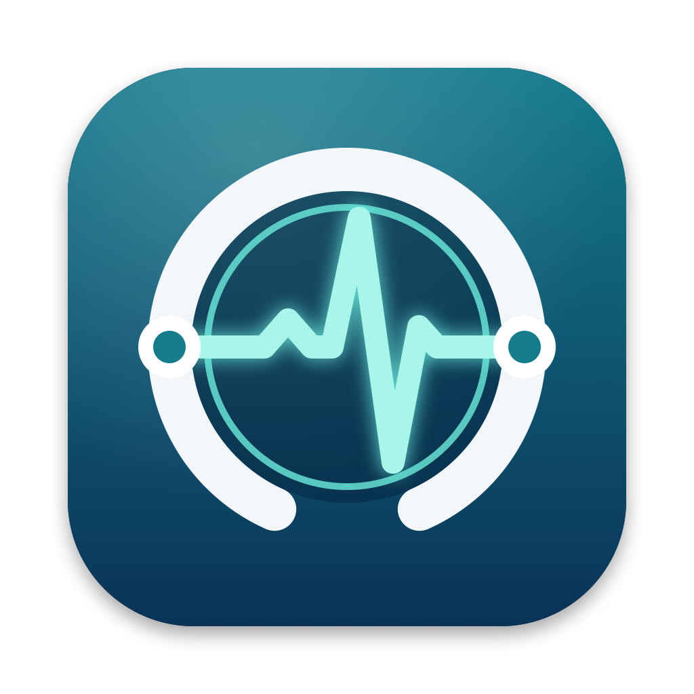

<p align="center">
  
</p>

<h1 align="center">DICOM Test Tool</h1>

<p align="center">
  <b>Natives macOS-Werkzeug zum Testen und zur Fehlersuche von DICOM-Verbindungen</b><br>
  Echo · Store · Query/Retrieve · Worklist · Storage SCP · Watchdog · Viewer
</p>

<p align="center">
  
  
  
  
</p>

<p align="center">
  <a href="../../releases/latest"><b>⬇️ Neueste Version herunterladen</b></a>
</p>

---

## Worum geht es?

**DICOM Test Tool** ist ein kostenloses Open-Source-Programm für den Mac. Administratoren, Medizintechnikerinnen und Medizintechniker sowie der IT-Support in Radiologie, Kliniken und Praxen prüfen damit schnell, ob die Kommunikation zwischen PACS, RIS, Modalitäten und Befundstationen funktioniert – und finden heraus, woran es hakt, wenn sie es nicht tut.

Die App ist vollständig in Swift geschrieben und bringt eine **eigene DICOM-Implementierung ohne Fremdbibliotheken** mit.

> [!WARNING]
> Dies ist ein Test- und Diagnosewerkzeug für die IT. Es ist **kein Medizinprodukt** und **nicht für diagnostische Zwecke** bestimmt.

## Funktionen

| Werkzeug | Was es macht |
|---|---|
| 🖧 **Knoten & Einstellungen** | Gegenstellen mit AE-Titel, Host und Port verwalten; eigener Calling AE und Timeout |
| 📡 **Echo (Verification)** | C-ECHO als „DICOM-Ping“ mit Zeitmessung (Assoziation, Echo, gesamt) und Wiederholungen |
| 📤 **Store (Senden)** | C-STORE von Dateien und Ordnern per Drag & Drop; Testbild-Generator ohne echte Patientendaten; automatische Umwandlung Implicit ↔ Explicit VR |
| 🔍 **Query / Retrieve** | C-FIND (Study/Patient Root) auf Patient-, Studien-, Serien- und Bildebene; Drill-down per Doppelklick; C-MOVE zu beliebigem Ziel |
| 📋 **Worklist** | Modality-Worklist-Abfrage beim RIS – so, wie es eine Modalität tun würde |
| 📥 **Storage SCP** | Macht den Mac zum DICOM-Empfänger; speichert sortiert nach Patienten-ID; ideal als C-MOVE-Ziel |
| ❤️ **Watchdog** | Überwacht Knoten dauerhaft per C-ECHO und meldet Ausfall und Wiederherstellung als macOS-Mitteilung |
| 🖼️ **Viewer / Tag-Dump** | Alle Tags inklusive Sequenzen mit Filter; Bildanzeige mit Fensterung, Multiframe, JPEG/JPEG 2000, PNG-Export |

**Außerdem:**

- 📍 **Menüleisten-Symbol** – SCP und Watchdog starten und stoppen, Echo senden, jedes Werkzeug öffnen, auch über Vollbild-Programmen
- 📝 **Protokoll** aller Abläufe inklusive Presentation-Context-Aushandlung, als TXT exportierbar
- 📅 **Datumsfelder mit Kalender** – oder direkt eintippen als `TTMMJJJJ` bzw. `TT.MM.JJJJ`
- 🎓 **Geführte Einführung** durch alle Werkzeuge
- 🎨 **Farbschemata:** Standard (macOS) oder Klinik Dunkel (Schwarz/Orange)
- 🔄 **Automatische Updates** über GitHub-Releases, mit Release Notes und Prüfung von Prüfsumme und Signatur
- 🚀 Start bei Anmeldung, Autostart von SCP und Watchdog, Log-Dateien (30 Tage)

## Installation

1. Unter [**Releases**](../../releases/latest) die Datei **`DICOM-Test-Tool.zip`** herunterladen.
2. Die ZIP-Datei per Doppelklick entpacken und **DICOM Test Tool** in den Ordner **Programme** ziehen.
3. Die App öffnen.

> [!IMPORTANT]
> **Beim ersten Start** blockiert macOS die App, weil sie nicht über den kostenpflichtigen Apple-Notarisierungsdienst beglaubigt ist.
> So geben Sie sie einmalig frei:
> 1. Die Meldung mit **Fertig** schließen.
> 2. **Systemeinstellungen › Datenschutz & Sicherheit** öffnen.
> 3. Ganz unten bei *„DICOM Test Tool“ wurde blockiert* auf **Dennoch öffnen** klicken und mit dem Passwort bestätigen.
>
> Danach startet die App ganz normal. Spätere Updates über die App brauchen diese Freigabe nicht erneut.

**Systemvoraussetzungen:** macOS 14 (Sonoma) oder neuer, Apple Silicon oder Intel.

## Updates

Die App sucht einmal täglich automatisch nach neuen Versionen. Gibt es eine, öffnet sich ein Fenster mit den Neuerungen und dem Button **„Installieren und neu starten“**.
Manuell geht es über **Über › Updates › Nach Updates suchen …** oder über das Menüleisten-Symbol.

Unter *Update-Kanal* lässt sich wählen, ob nur **stabile Versionen** oder auch **Vorabversionen** angeboten werden.

## Erste Schritte

1. **Knoten & Einstellungen** öffnen, den eigenen *Calling AE-Titel* eintragen und eine Gegenstelle (AE-Titel, IP, Port) anlegen.
2. Mit **Echo** die Verbindung testen.
3. Mit **Store** Testbilder senden oder mit **Query / Retrieve** im PACS suchen.

Die geführte Tour gibt es jederzeit im Menüleisten-Menü unter **Einführung …**

## Bekannte Einschränkungen

- Kein DICOM Print, kein C-GET, kein TLS.
- Viewer: JPEG Lossless, JPEG-LS und RLE werden nicht dekodiert (die Tags werden trotzdem angezeigt).
- Deflated und Explicit VR Big Endian können nicht gelesen werden (Empfangen und Weitersenden funktioniert).

## Fehler melden und Wünsche

Fehler und Ideen bitte als [**Issue**](../../issues) melden. Am hilfreichsten ist ein exportiertes Protokoll (**Protokoll › Exportieren …**) – vorher bitte Patientendaten entfernen.

---

## Für Entwickler

<details>
<summary><b>Aus dem Quellcode bauen</b></summary>

Voraussetzung: Xcode 15 oder neuer (bzw. die Command Line Tools mit Swift 5.9+).

```bash
./build-app.sh
```

Ergebnis in `dist/`: `DICOM Test Tool.app`, `DICOM-Test-Tool.zip` samt `.sha256` und das Kommandozeilen-Werkzeug `dicomcli`.

</details>

<details>
<summary><b>Release veröffentlichen</b></summary>

1. Version in `VERSION` erhöhen und in `CHANGELOG.md` einen Abschnitt `## <Version>` anlegen.
2. `./release.sh` ausführen: baut die App und erzeugt ZIP, `.sha256` und `dist/RELEASE_NOTES.md`.
3. Auf GitHub ein Release mit dem Tag `vX.Y.Z` anlegen, den Inhalt von `RELEASE_NOTES.md` als Beschreibung verwenden und **`DICOM-Test-Tool.zip`** sowie **`DICOM-Test-Tool.zip.sha256`** anhängen. Die Dateinamen dürfen nicht geändert werden.

Die App fragt `https://api.github.com/repos/<owner>/<repo>/releases/latest` ab. Der Standard steht in `AppInfo.defaultRepository`; das Repository lässt sich unter *Über › Updates › GitHub-Repository* ändern.
Zum Testen ohne GitHub zeigt `DICOMTESTTOOL_UPDATE_API=http://127.0.0.1:8765` auf einen lokalen Mock-Server.

</details>

<details>
<summary><b>Kommandozeile (<code>dicomcli</code>)</b></summary>

```
dicomcli echo  <host> <port> <calledAE>
dicomcli store <host> <port> <calledAE> <datei|ordner>...
dicomcli find  <host> <port> <calledAE> [patientenname]
dicomcli mwl   <host> <port> <calledAE> [patientenname]
dicomcli move  <host> <port> <calledAE> <zielAE> <studyUID>
dicomcli scp   <port> <aeTitel> <ordner>
dicomcli testimage <ordner> [anzahl]
dicomcli dump  <datei>
dicomcli png   <datei> <ausgabe.png>
```

Den Calling AE setzt die Umgebungsvariable `DICOM_AET` (Standard: `DICOMCLI`).

</details>

<details>
<summary><b>Projektaufbau</b></summary>

| Ordner | Inhalt |
|---|---|
| `Sources/DicomCore` | DICOM-Implementierung: PDU, Assoziation, DIMSE, Datensätze, Part-10-Dateien, Bilddarstellung |
| `Sources/DICOMTestTool` | SwiftUI-App |
| `Sources/dicomcli` | Kommandozeilen-Werkzeug |
| `Scripts` | Icon-Generator |

</details>

## Lizenz

[MIT](LICENSE) © 2026 Martin Senft, Brakel
